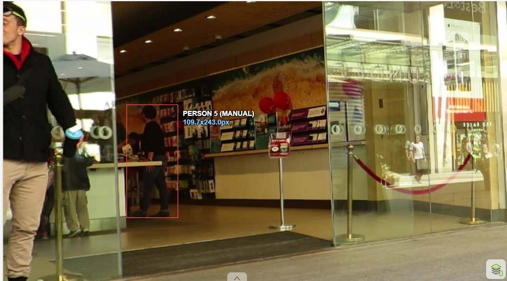
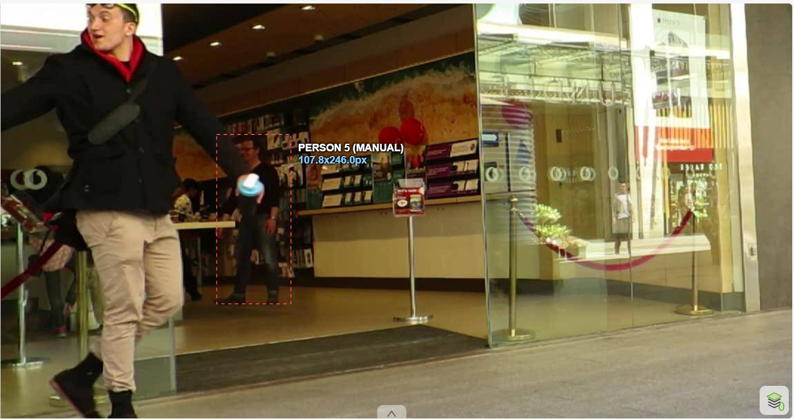
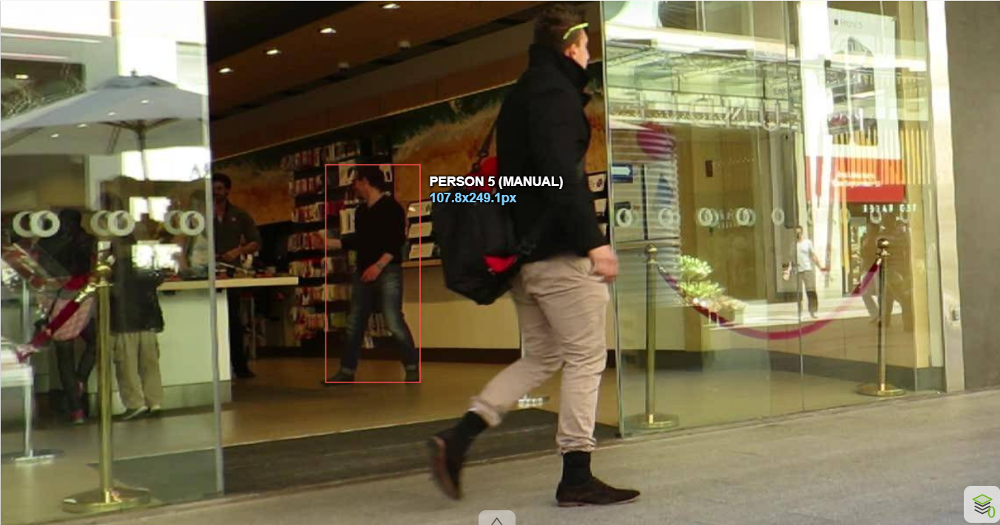

# Báo cáo cá nhân — Hồ Trung Kiên (2A202603090)

## 0. Thông tin học viên

- Họ tên: Hồ Trung Kiên
- MSSV: 2A202603090
- Mã đề: A
- Email: hotrungkien30092005@gmail.com
- Repository: [K5-L2A-DAY05-HoTrungKien-2A202603090-MOTTracking](https://github.com/TrungKien0905/K5-L2A-DAY05-HoTrungKien-2A202603090-MOTTracking)
- Giờ bắt đầu (GMT+7): **16h00**
- Giờ kết thúc (GMT+7): **18h45**

Dữ liệu sử dụng là đoạn MOT17-09 gồm 150 frame ở 30 fps, nguồn MOTChallenge, giấy phép CC BY-NC-SA 3.0. Báo cáo dùng số frame theo CVAT (0–149). Trong file MOT, số frame bằng số frame CVAT cộng 1.

## 1. Xem trước đoạn video (CP0)

Bảng dưới đây được đối chiếu lại từ file xuất sau khi gán nhãn. Các mốc che phản ánh cờ đã gán trong CVAT.

| Mã | Frame xuất hiện | Frame cuối thấy được | Diễn biến | Bị che ở frame | Ghi chú |
|---|---:|---:|---|---|---|
| P1 | 0 | 149 | Đi sang phải trong cửa hàng, tâm box dịch nhẹ sang trái khoảng frame 100–125 | Che một phần 25–41 và 44–54, khuất hẳn 42–43 | Áo tối màu, ở phía sau người đi ngang tiền cảnh |
| P2 | 61 | 149 | Dịch sang phải rõ trong khoảng 61–101, sau đó dịch ngang ít hơn | Che một phần 61–100 | Không có đoạn khuất hẳn trong file xuất |
| P3 | 0 | 149 | Đi từ phải sang trái và đến gần camera, box lớn dần | Không bật cờ che | Box dịch sang trái nhanh hơn trong phần sau của clip |
| P4 | 39 | 149 | Vào từ mép phải, sau đó dịch sang trái và tiến gần camera | Không bật cờ che | Box bị giới hạn bởi mép phải ở các frame đầu của track |
| P5 | 0 | 149 | Dịch nhẹ sang phải, box thay đổi ít trong đoạn 34–105 | Che một phần 105–111, 135–140, 142–149, khuất hẳn 112–134 | Hiện lại tại frame 135 trên cùng track |

## 2. Keyframe và thời gian (CP1, CP4)

| Mã | ID CVAT | ID MOT | Số keyframe | Keyframe ở frame | Số frame có mặt | Keyframe / 100 frame | Thời gian (phút) | Chỗ khó |
|---|---:|---:|---:|---|---:|---:|---|---|
| P1 | 1 | 2 | 17 | 0, 11, 22, 25, 32, 44, 47, 55, 57, 64, 70, 82, 92, 101, 122, 136, 149 | 148 | 11,5 | **10** | P1 khuất hẳn ở frame 42–43 rồi hiện lại ở frame 44. |
| P2 | 4 | 5 | 11 | 61, 64, 67, 74, 81, 87, 96, 101, 122, 127, 142 | 89 | 12,4 | **10** | P2 bị che một phần liên tục ở frame 61–100. |
| P3 | 2 | 3 | 41 | 0, 2, 4, 5, 10, 17, 23, 28, 40, 49, 51, 58, 60, 67, 76, 77, 78, 80, 82, 88, 93, 97, 99, 101, 103, 107, 108, 110, 117, 121, 123, 124, 132, 134, 136, 138, 140, 141, 144, 147, 149 | 150 | 27,3 | **10** | Box lớn dần khi P3 tiến gần camera, cần chỉnh vị trí và kích thước thường xuyên. |
| P4 | 3 | 4 | 40 | 39, 46, 51, 53, 57, 58, 63, 69, 71, 73, 77, 85, 92, 93, 94, 95, 97, 99, 101, 103, 105, 107, 112, 115, 116, 118, 120, 123, 126, 128, 130, 134, 135, 137, 141, 144, 145, 146, 147, 149 | 111 | 36,0 | **10** | P4 xuất hiện ở mép phải tại frame 39. Box thay đổi nhanh khi P4 tiến gần camera. |
| P5 | 0 | 1 | 17 | 0, 5, 6, 9, 10, 11, 15, 17, 20, 24, 34, 105, 135, 140, 141, 142, 149 | 127 | 13,4 | **10** | P5 khuất hẳn ở frame 112–134, cần đối chiếu người xuất hiện lại ở frame 135. |
| **Tổng** | | | **126** | | **625** | **20,2** | **50** | |

Tỉ lệ chung là 126 ÷ 625 × 100 ≈ **20,2 keyframe trên 100 frame có mặt**. P3 có số keyframe cao nhất (41). Khi P3 tiến về phía camera, vị trí và kích thước box thay đổi nhanh hơn ở phần sau, vì vậy đoạn này có nhiều mốc hiệu chỉnh nội suy. P4 có mật độ keyframe cao nhất, với 40 keyframe trên 111 frame có mặt.

## 3. Đoạn bị che (CP2)

Người bị che là **P1** (track 1 trong XML, track 2 trong MOT). Ảnh minh họa hiển thị nhãn **PERSON 5** trên giao diện CVAT.

| Mốc | Frame CVAT |
|---|---:|
| Bắt đầu bị che một phần, bật `occluded` | 25 |
| Khuất hẳn, bật `outside` | 42 |
| Hiện lại, tắt `outside` | 44 |
| Thấy rõ trở lại, tắt `occluded` | 55 |

P1 khuất hẳn trong **2 frame** (42–43), tương đương khoảng **0,067 giây** ở 30 fps, dưới ngưỡng 60 frame của bài. Track giữ nguyên ID khi P1 hiện lại. Trước và sau khi người đi tiền cảnh che khuất, P1 vẫn có áo tối màu và quần dài, ở cùng khu vực trong cửa hàng. Vị trí xuất hiện lại tiếp nối hướng dịch sang phải. Tâm box từ frame 41 đến 44 dịch khoảng 10 px, phù hợp với mức dịch chuyển của track quanh đoạn bị che.







*Nguồn ảnh: MOT17, MOTChallenge (Milan et al., 2016).*

Đoạn khuất thứ hai trong file xuất là P5 (ID CVAT 0, ID MOT 1). P5 khuất hẳn ở frame 112–134, tổng cộng 23 frame (khoảng 0,77 giây ở 30 fps), rồi xuất hiện lại tại frame 135 trên cùng ID.

## 4. Tự review ID (CP3)

Lượt 1 theo từng người, tua ngược từ frame 149 về 0. Lượt 2 theo cảnh, nhảy mỗi 10 frame. Đối chiếu thêm quanh frame 41–44 của P1 và 111–135 của P5. Ghi kết quả quan sát vào bảng sau.

| Frame | Mã người | Loại lỗi | Mô tả | Phát hiện ở lượt | Đã sửa? |
|---:|---|---|---|---|---|
|41-44 |P1 |Không có |Không có |Không có |Không có |
|111-135 |P5 |Không có |Không có |Không có |Không có |

| `id_switch` | `fragmentation` | `lost` | `merge` | `false_track` | `drift` | `flag` |
|---:|---:|---:|---:|---:|---:|---:|
| | | | | | | |

**Lỗi chỉ thấy ở lượt 2 và lý do:** [Điền kết quả quan sát trên CVAT.]

## 5. File xuất và kết quả tự kiểm (CP4)

| Kiểm tra | Kết quả |
|---|---|
| File MOT 1.1 | `HoTrungKien_mot.zip` |
| File CVAT for video 1.1 | `HoTrungKien_cvat_video.zip` |
| Số track ID khác nhau trong `gt/gt.txt` | 5 |
| Các frame `outside` có bị loại khỏi `gt.txt`? | Có. Đã đối chiếu toàn bộ frame có mặt của cả 5 track giữa XML và MOT |
| Hai file ZIP xuất không kèm ảnh | Đã kiểm tra |
| Trạng thái `completed` của job trên CVAT | **completed** |

Kết quả chạy `src/check_submission.py`:

```text
Số frame in theo CVAT (bắt đầu từ 0). Trong gt.txt, frame_id = frame CVAT + 1.

=== File MOT 1.1: HoTrungKien_mot.zip ===
  Số track ID: 5   |   Tổng số box: 625
  [OK]        Đúng 5 track ID.

  Track | Frame có mặt | Số frame | Đoạn vắng (outside)
      1 |   0–149      |      127 | 112–134
      2 |   0–149      |      148 | 42–43
      3 |   0–149      |      150 | -
      4 |  39–149      |      111 | -
      5 |  61–149      |       89 | -


=== File CVAT for video 1.1: HoTrungKien_cvat_video.zip ===

  Track | Nhãn   | Frame thấy | Keyframe | KF/100 frame | Frame occluded | Lần bật outside
      0 | person |        127 |       17 |         13.4 |             21 |               1
              Track 0: keyframe ở frame [0, 5, 6, 9, 10, 11, 15, 17, 20, 24, 34, 105, 135, 140, 141, 142, 149]
      1 | person |        148 |       17 |         11.5 |             28 |               1
              Track 1: keyframe ở frame [0, 11, 22, 25, 32, 44, 47, 55, 57, 64, 70, 82, 92, 101, 122, 136, 149]
      2 | person |        150 |       41 |         27.3 |              0 |               0
              Track 2: keyframe ở frame [0, 2, 4, 5, 10, 17, 23, 28, 40, 49, 51, 58, 60, 67, 76, 77, 78, 80, 82, 88, 93, 97, 99, 101, 103, 107, 108, 110, 117, 121, 123, 124, 132, 134, 136, 138, 140, 141, 144, 147, 149]
      3 | person |        111 |       40 |         36.0 |              0 |               0
              Track 3: keyframe ở frame [39, 46, 51, 53, 57, 58, 63, 69, 71, 73, 77, 85, 92, 93, 94, 95, 97, 99, 101, 103, 105, 107, 112, 115, 116, 118, 120, 123, 126, 128, 130, 134, 135, 137, 141, 144, 145, 146, 147, 149]
      4 | person |         89 |       11 |         12.4 |             40 |               0
              Track 4: keyframe ở frame [61, 64, 67, 74, 81, 87, 96, 101, 122, 127, 142]

  Tổng: 126 keyframe / 625 frame có mặt = 20.2 keyframe / 100 frame
  [OK]        Đọc được 5 track từ annotations.xml.

=== Tóm tắt ===
  Lỗi: 0   |   Cảnh báo: 0
  Đạt. Dán phần tóm tắt này vào báo cáo mục 5.
```

## 6. Ba câu kết

1. Nếu được gán lại, bạn sẽ đặt keyframe khác ở đâu? Vì sao?
Em sẽ kiểm tra kỹ đoạn frame 122–136 của P1 và ưu tiên đặt thêm một keyframe quanh frame 129 nếu box bị lệch. Khoảng cách giữa hai keyframe là 14 frame, nên nếu P1 đổi tốc độ ở giữa đoạn, box nội suy tuyến tính có thể đi trước hoặc chậm hơn người thật.
2. Có chỗ nào bạn không chắc nên giữ ID hay tạo ID mới? Bạn đã quyết định và ghi chú thế nào?
Trường hợp khó nhất là P5 vì người này khuất hẳn trong 23 frame, từ frame 112 đến 134. Em giữ cùng ID khi P5 xuất hiện lại ở frame 135. Em ghi lại mốc bật outside ở frame 112 và tắt outside ở frame 135 để có thể kiểm tra lại đoạn này.
3. Một lỗi ID trong job có thể ảnh hưởng thế nào đến dự đoán chuyển động của người đi bộ? Lỗi đó ảnh hưởng MOTA hay IDF1 nhiều hơn?
Ví dụ, nếu ID của P1 bị gán sang người đi ngang tiền cảnh, hệ thống có thể nối vị trí của hai người thành một quỹ đạo. Vị trí sẽ nhảy đột ngột giữa hai frame, khiến xe ước lượng sai hướng hoặc tốc độ của người đi bộ. Nếu ID sai kéo dài qua nhiều frame, IDF1 thường phản ánh lỗi rõ hơn vì nó đánh giá mức độ khớp danh tính qua cả quỹ đạo. MOTA cũng giảm do có lần đổi ID, đồng thời tính cả các lỗi bỏ sót và phát hiện thừa.

## 7. Tài liệu tham khảo và công cụ AI

- Dữ liệu MOT17-09 và ảnh minh họa từ [MOTChallenge](https://motchallenge.net/data/MOT17/).
- Quy tắc che khuất, nội suy và định dạng xuất theo [guideline Day 05](../../docs/GUIDELINE.md) và [tài liệu MOT 1.1 của bài lab](../../docs/MOT_FORMAT.md).
- Dùng CVAT để gán nhãn và xuất track, dùng `src/check_submission.py` để kiểm tra hai file xuất.
- Dùng ChatGPT để tra cứu khái niệm tracking, hỏi cách dùng CVAT, đối chiếu số liệu từ file xuất và biên tập báo cáo.
